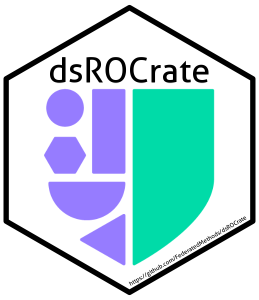
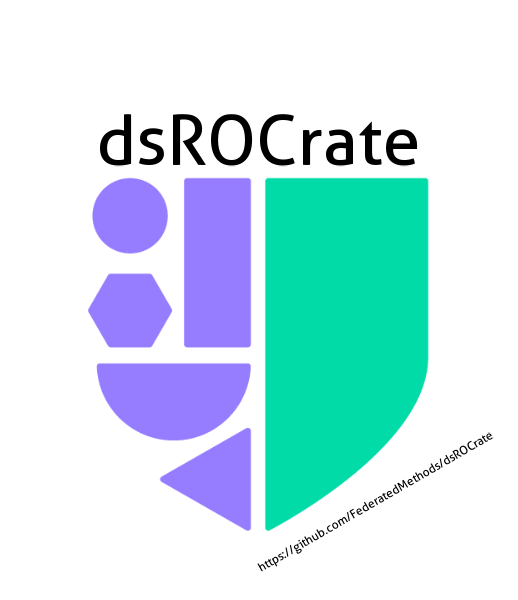
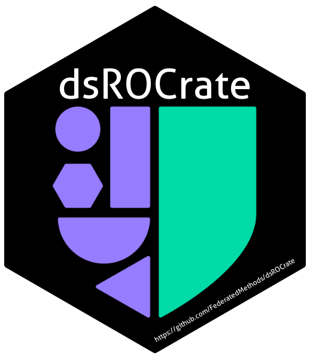

<!-- README.md is generated from README.Rmd. Please edit that file -->

# dsROCrate: ‘DataSHIELD’ RO-Crate Governance Functions 

<!-- badges: start -->

[](https://CRAN.R-project.org/package=dsROCrate)
[](https://github.com/FederatedMethods/dsROCrate/actions/workflows/R-CMD-check.yaml)
[](https://lifecycle.r-lib.org/articles/stages.html#experimental)
<!-- badges: end -->

## Overview

`{dsROCrate}` provides tools to capture, structure and audit
[DataSHIELD](https://datashield.org) analyses using the
[RO-Crate](https://www.researchobject.org/ro-crate/) standard and the
[Five
Safes](https://www.researchdata.scot/engage-and-learn/data-explainers/what-is-the-five-safes-framework/)
framework. It enables reproducible governance of federated analyses by
packaging inputs, outputs, metadata and audit information into a
consistent, portable format, and turns the result into a human-readable
report.

## Installation

You can install the released version of `{dsROCrate}` from
[CRAN](https://cran.r-project.org/package=dsROCrate) with:

``` r
install.packages("dsROCrate")
```

And the development version from
[GitHub](https://github.com/FederatedMethods/dsROCrate/) with:

``` r
# install.packages("pak")
pak::pak("FederatedMethods/dsROCrate@dev")
```

## Requirements

| Backend | Status | Minimum version | Account needed |
|----|----|----|----|
| [OBiBa Opal](https://www.obiba.org/pages/products/opal/) | Supported | 5.7.2 (6.0 to capture `RESOLVE` operations in the outputs) | Administrator, or a user with the `Audit system` permission |
| [MOLGENIS Armadillo](https://molgenis.github.io/molgenis-service-armadillo/) | In development | – | – |

Auditing reads server-wide information (users, system permissions,
DataSHIELD settings and logs), so a standard analyst account is not
enough. We recommend a dedicated auditor account, see
`vignette("audit-permissions", package = "dsROCrate")`.

## Key Features

- Create RO-Crates for DataSHIELD workflows
- Capture project metadata, data references and analysis outputs
- Record and audit disclosure control processes
- Support reproducibility and governance in federated environments

**Which function should I use?**

| I want to… | Use |
|----|----|
| Check my account can audit before starting | `check_permissions()` |
| Audit a whole project in one call (people, project, data, setting, outputs) | `audit()` |
| Build a crate step by step, inspecting each Safe | `init()`, then `safe_people()` … `safe_output()` |
| Produce a Markdown/HTML report from a crate, or from several servers | `report()` |

## Quick Start

The examples use OBiBa’s public demo server and its default
administrator account. For real servers, use an auditor account.

``` r
# open connection
con <- opalr::opal.login(
  username = "administrator",
  password = "password",
  url = "https://opal-demo.obiba.org"
)

# check the account has sufficient permissions to audit
dsROCrate::check_permissions(con, verbose = TRUE)
```

### Audit a project

``` r
# generate RO-Crate with Five Safes components
proj_audit <- con |>
  dsROCrate::audit(project = "CNSIM", tables = "CNSIM1", user = "dsuser")

# generate report
dsROCrate::report(proj_audit, title = "DataSHIELD Five Safes report")
```

If `user` is omitted, all non-administrator, non-auditor accounts are
included. Use `logs_from` and `logs_to` to limit the period covered by
the outputs, and `path` to store the log files next to the crate instead
of inside it.

### Build the crate step by step

Alternatively, it’s possible to extract only partial components from the
Five Safes, by calling or skipping them as follows. `init()` records the
connection and study details once, so the `safe_*()` functions need no
further arguments:

``` r
proj_crate <- con |>
  # initialise RO-Crate
  dsROCrate::init(project = "CNSIM", tables = "CNSIM1", user = "dsuser") |>
  # extract Five Safes components
  dsROCrate::safe_people() |>
  dsROCrate::safe_project() |>
  dsROCrate::safe_data() |>
  dsROCrate::safe_setting() |>
  dsROCrate::safe_output()

# generate report
dsROCrate::report(proj_crate, title = "DataSHIELD Five Safes report")
```

Run `safe_people()` first, so the later steps can leave administrator
and auditor accounts out of the permissions recorded for the data.

``` r
# close connection
opalr::opal.logout(con)
```

### Several servers

`audit()` and `report()` also accept a named list of connections, e.g.,
for a study spanning several sites:

``` r
study_audit <- list(site_a = con_a, site_b = con_b) |>
  dsROCrate::audit(project = "CNSIM")

dsROCrate::report(study_audit, title = "DataSHIELD study audit")
```

## Learn More

| Vignette | Content |
|----|----|
| `vignette("getting-started", package = "dsROCrate")` | Connect, check permissions, audit a project and create a report |
| `vignette("building-crates", package = "dsROCrate")` | Build the RO-Crate one Safe at a time with `init()` and `safe_*()` |
| `vignette("auditing-studies", package = "dsROCrate")` | Audit and report on several servers as one study |
| `vignette("audit-permissions", package = "dsROCrate")` | Create an auditor account and understand the permission checks |
| `vignette("deploy-local-datashield-server-with-opal", package = "dsROCrate")` | Run a local Opal/DataSHIELD server with Docker for testing |

Questions, bugs and feature requests: [GitHub
issues](https://github.com/FederatedMethods/dsROCrate/issues).

## Identity

You are welcome to use any of the following logos when referencing
`{dsROCrate}`:

<p>

<a href="man/figures/logo.png"></a>
<a href="man/figures/logo_white.png"></a>
<a href="man/figures/logo_black.png"></a>
</p>
